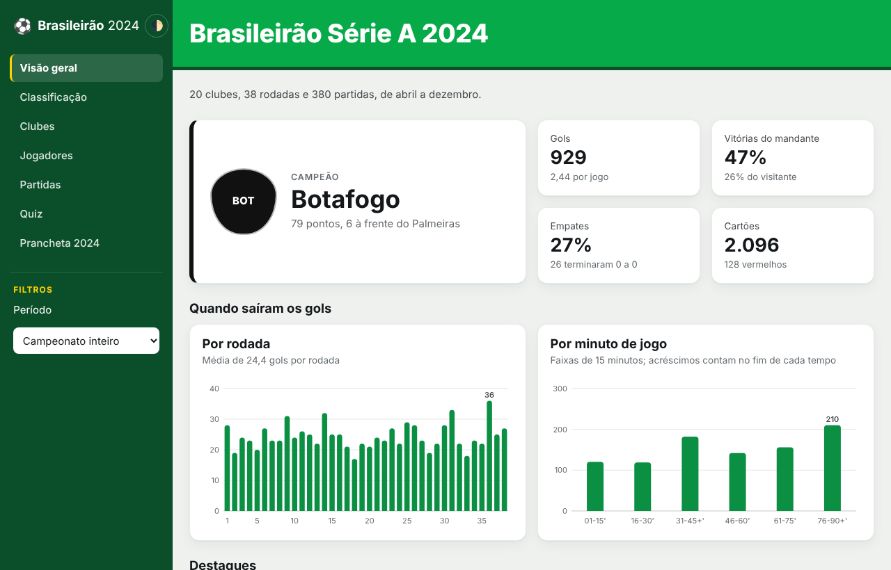
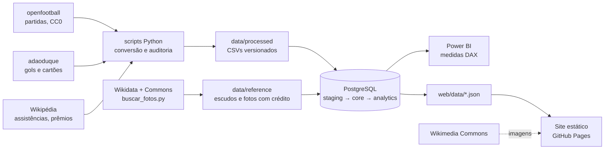
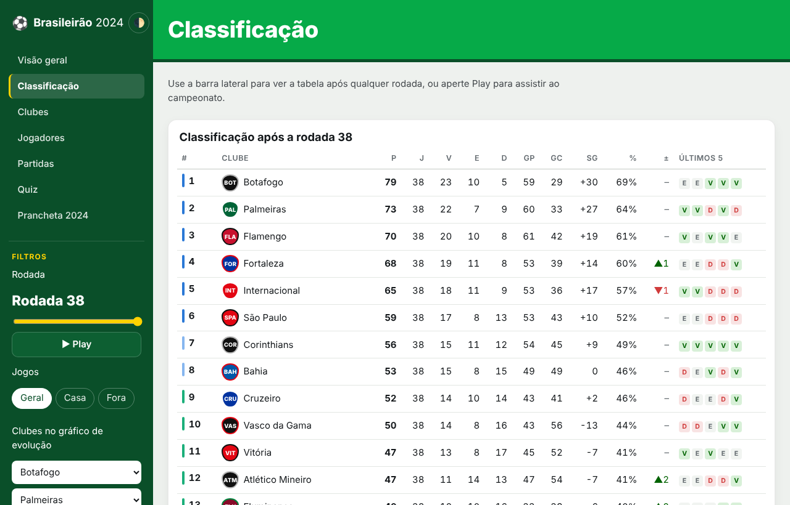
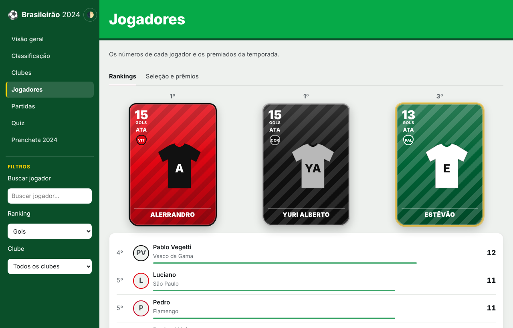
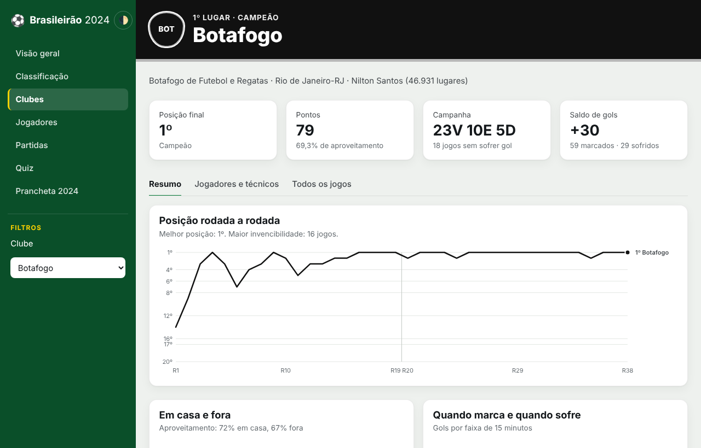
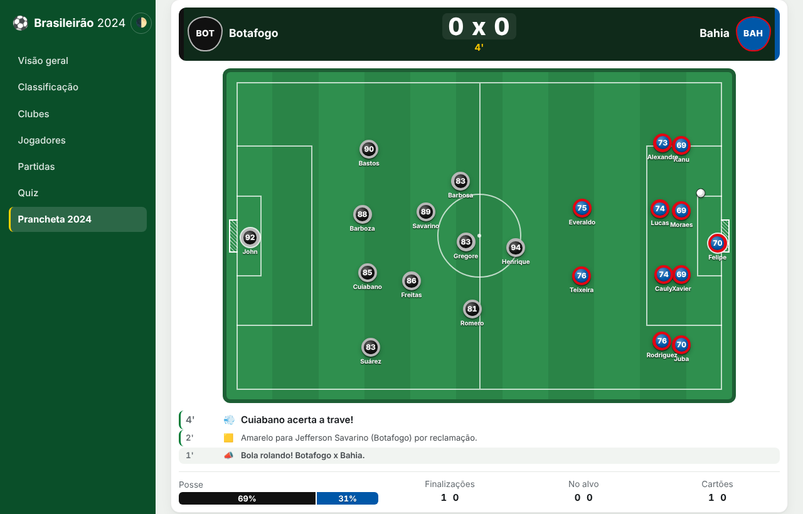
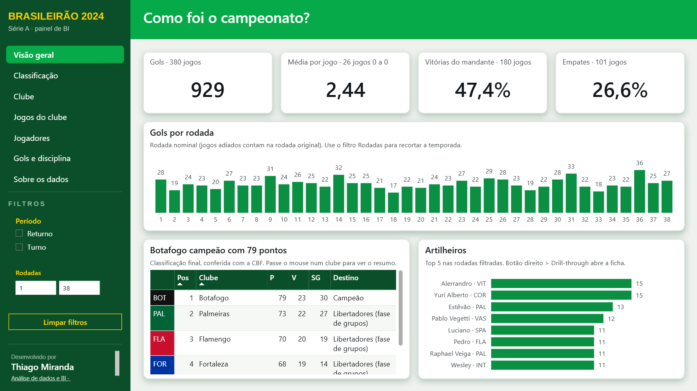
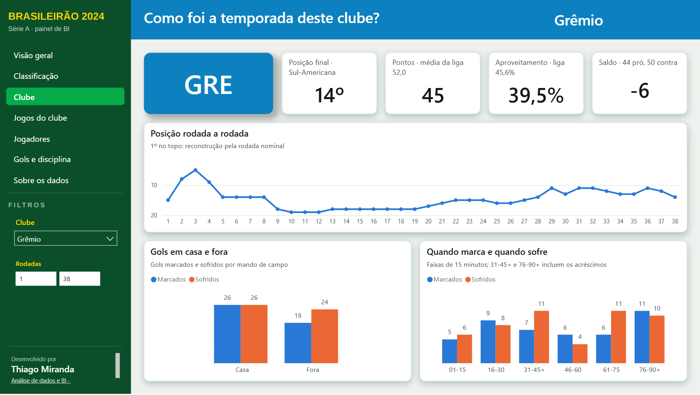

# Brasileirão 2024: Business Intelligence de ponta a ponta

Projeto de portfólio sobre o **Campeonato Brasileiro Série A 2024**: dados públicos auditados,
modelagem relacional em **PostgreSQL**, camada analítica em SQL, dashboard no **Power BI** e um
**site interativo** com estatísticas, escudos, fotos de jogadores e um jogo de técnico.

> 🌐 **Acesse o site:** [thiagomiranda396.github.io/Brasileir-o2024](https://thiagomiranda396.github.io/Brasileir-o2024/)
> (publicado pelo GitHub Pages a partir da pasta `web/`)



## Destaques

- **Dados conferidos, não só coletados.** A classificação final reconstruída a partir das 380
  partidas é igual à tabela oficial da CBF (20 clubes × 9 campos). Os 929 gols, um a um, batem com
  o placar de cada partida, e a artilharia bate com a da Wikipédia.
- **Modelo relacional completo:** 12 tabelas com chaves primárias e estrangeiras, `CHECK`s de regra
  de negócio, carga transacional e idempotente com `MERGE`, auditoria de cada carga e 23 testes SQL.
- **Uma fonte da verdade:** o Power BI e o site leem as mesmas views do schema `analytics`, por um
  papel somente leitura.
- **Para analisar e para se divertir:** classificação rodada a rodada com "play", evolução das
  posições, página de cada clube e de cada jogador, partidas com gols minuto a minuto e a
  **Prancheta 2024**, um jogo de técnico em que você escala um clube e
  disputa um mata-mata das quartas à final.
- **130 testes em Python** (um deles roda os testes do motor do jogo em Node) e CI no GitHub Actions que recria o banco do zero a cada push.

## Arquitetura



## O site

| Página | O que tem |
|---|---|
| Visão geral | Campeão e quatro números do campeonato, gols por rodada e por minuto, seis destaques da temporada |
| Classificação | Tabela após qualquer rodada (com animação), geral, casa ou fora, zonas de classificação, evolução de posições |
| Clubes | Quatro indicadores e três abas: resumo (posição por rodada, casa e fora, quando marca e sofre), jogadores e técnicos, todos os jogos |
| Jogadores | Duas abas: rankings (gols, assistências, goleiros, pênaltis, cartões, com pódio e lista expansível) e seleção do campeonato com os prêmios mensais; página de cada jogador |
| Partidas | Os 380 jogos com gols minuto a minuto, expulsões, estádio e técnicos |
| Minijogos | **Prancheta 2024**, jogo de técnico: escolha um dos 20 clubes, monte a escalação com botões de futebol de mesa nas cores do clube (tocar ou arrastar, funciona no celular) e dispute um mata-mata de 8 times. As partidas rolam num campo visto de cima, com placar, narração, velocidade 1x/2x ou só o resultado, e dá para pausar e mexer no time (substituições, formação e postura). Tem cansaço, cartões e pênaltis interativos. A força de cada elenco vem do desempenho real de 2024 (pontos, gols pró e contra, artilharia, assistências, seleção e prêmios do mês) |

| Classificação | Jogadores |
|---|---|
|  |  |
| **Clube** | **Minijogos** |
|  |  |

Visual de dashboard com identidade inspirada no ge: barra lateral em verde com o menu e os filtros de cada página, faixa do título em verde e, na página de cada clube, a faixa e os gráficos nas cores do time. Cada página responde a uma pergunta, com os números principais no topo, um gráfico que os explica e os detalhes em abas ou em "mostrar mais". Cartões e painéis têm profundidade em três níveis (fundo plano, painéis com sombra discreta, indicadores e destaques um nível acima), com sombras próprias para o tema claro e para o escuro, definidas uma vez como variáveis no CSS. Jogadores aparecem em cartas no estilo dos games, com a foto livre da Wikimedia quando existe. HTML, CSS e JavaScript puros, sem dependências nem etapa de build. Gráficos em SVG próprios, com
tooltip, navegação por teclado, tema claro e escuro e layout para celular.

**Fotos sem homônimos.** Cada foto só entra quando uma fonte independente confirma que a pessoa
jogou naquele clube em 2024 e tem o mesmo nome do jogador: o vínculo na Wikidata ou, quando a
Wikidata não o registra, a ficha da página do jogador na Wikipédia em inglês. O arquivo precisa ter licença livre (CC0,
domínio público, CC BY ou CC BY-SA) com autor. O script `scripts/buscar_fotos.py` grava a
referência e o crédito de cada imagem no banco; o site carrega a imagem da Wikimedia Commons e
mostra os créditos. No Power BI não há imagens externas: o clube aparece num selo com a sigla nas
cores dele e o jogador, pelo nome. Quem ficou sem confirmação aparece com a camisa do clube, sem um
rosto inventado. A cobertura está em [docs/qualidade/fotos_jogadores.md](docs/qualidade/fotos_jogadores.md).

## Banco de dados

Três camadas no banco `brasileirao2024` ([modelo completo](docs/modelagem/modelo_dados.md)):

| Schema | Conteúdo |
|---|---|
| `staging` | Espelho dos CSVs, tudo `text`, e as funções genéricas de sincronização |
| `core` | `clube`, `partida`, `partida_complemento`, `jogador`, `gol`, `cartao`, `ranking_wikipedia`, `selecao_campeonato`, `premio_mensal`, `escudo_clube`, `foto_jogador`, `carga_execucao` |
| `analytics` | Dimensões, fatos (`fato_partida`, `fato_participacao`, `fato_gol`, `fato_cartao`), `classificacao_rodada` (com confronto direto), `classificacao_final`, `jogador_estatisticas`, `credito_imagem` (autor e licença de cada imagem) |

Cada métrica é calculada no seu grão: os gols do campeonato vêm de `fato_partida` (929), não da
soma por clube (que daria 1.858). O papel `bi_brasileirao_leitura` só enxerga o `analytics`.

## Power BI

O dashboard é um projeto do Power BI (`powerbi/Brasileirao2024.pbip`): modelo estrela em TMDL com
95 medidas e relatório de 11 páginas em PBIR (7 visíveis, uma de drill-through, duas de dica de
ferramenta e uma de auditoria), lendo os CSVs das views do `analytics`.





- **Layout feito no PowerPoint:** [`powerbi/design/Brasileirao2024_layout_powerbi.pptx`](powerbi/design/Brasileirao2024_layout_powerbi.pptx)
  registra o processo na ordem em que foi feito (objetivos, perguntas e KPIs, wireframe, grid de
  12 colunas, identidade visual) e traz o fundo de cada página, aplicado no relatório como imagem.
- **Recursos avançados:** drill-through para a ficha do jogador, páginas de dica de ferramenta
  para clube e jogador, indicadores que alternam *Evolução* e *Comparar clubes* na Classificação,
  parâmetro de campo `Métrica do clube` e segmentações sincronizadas entre páginas (rodadas, clube
  e período).

O [guia](powerbi/README.md) explica como abrir no Power BI Desktop, atualizar e publicar no Power BI Service.

## Como executar

Requisitos: Python 3.11+ (só biblioteca padrão), PostgreSQL 15+ (testado no 16 e no 18) e,
para o dashboard, Power BI Desktop. Comandos para Windows/PowerShell, na raiz do projeto.

```powershell
# 1. Testes dos dados (não precisa de banco nem de rede)
py -3.14 -I -X utf8 -m unittest discover -s tests -v

# 2. Banco: papéis e banco (uma vez, como superusuário; ver docs/modelagem/criacao_banco.md)
$psql = "C:\Program Files\PostgreSQL\18\bin\psql.exe"
& $psql -v ON_ERROR_STOP=1 -U postgres -d postgres -f sql/00_criar_banco_e_papel.sql

# 3. Estrutura, carga, views e testes SQL
& $psql -v ON_ERROR_STOP=1 -U bi_brasileirao -d brasileirao2024 -f sql/executar_tudo.sql

# 4. (Opcional) Exportar de novo os dados do site e os CSVs do Power BI
py -3.14 -I scripts/exportar_web.py --psql $psql
& $psql -v ON_ERROR_STOP=1 -U bi_brasileirao_leitura -d brasileirao2024 -f sql/06_exportar_csv.sql

# 5. Abrir o site localmente
py -3.14 -m http.server 8000 -d web    # e acesse http://localhost:8000
```

Para regenerar os dados a partir das fontes:

```powershell
py -3.14 -I scripts/baixar_fontes.py --auditoria   # baixa as fontes nas versões fixadas (confere SHA-256)
py -3.14 -I scripts/converter_openfootball.py      # partidas
py -3.14 -I scripts/preparar_jogadores.py          # gols, cartões, jogadores (confere com os placares)
py -3.14 -I -X utf8 scripts/validar_dados.py       # relatório de validação das partidas
py -3.14 -I scripts/buscar_fotos.py                # escudos e fotos (Wikidata + Commons; precisa de internet)
```

**Publicar o site:** em *Settings → Pages* do repositório, escolha *Source: GitHub Actions*. O
workflow `.github/workflows/pages.yml` publica a pasta `web/` a cada push que a altere.

## Estrutura

```
.
├── data/
│   ├── raw/              # fontes brutas em versões fixadas + PROCEDENCIA.json (URL, versão, SHA-256)
│   ├── processed/        # partidas, gols, cartões, jogadores, complemento das partidas
│   ├── reference/        # clubes, cores e estádios, nomes de jogadores, listas da Wikipédia
│   └── external/         # (fora do Git) fontes sem licença de redistribuição
├── sql/                  # 00 papéis e banco · 01 schemas · 02 tabelas · 03 carga · 04 views · 05 testes · 06 exportação
├── scripts/              # baixar, converter, preparar jogadores, validar, exportar para o site
├── tests/                # 130 testes (unittest)
├── web/                  # site estático (GitHub Pages)
├── powerbi/              # projeto do Power BI (PBIP), layout no PowerPoint, medidas DAX, tema, guia e CSVs
├── docs/                 # fontes, regras, modelagem, auditorias, imagens
└── .github/workflows/    # CI (Python + PostgreSQL) e publicação do site
```

## Fontes de dados e licenças

| Fonte | Uso | Licença |
|---|---|---|
| [openfootball/south-america](https://github.com/openfootball/south-america) | Partidas e placares | CC0 1.0 |
| [adaoduque/Brasileirao_Dataset](https://github.com/adaoduque/Brasileirao_Dataset) | Gols, cartões, técnicos e estádios por partida (só os fatos derivados são publicados) | Não declarada |
| [Wikipédia (en)](https://en.wikipedia.org/wiki/2024_Campeonato_Brasileiro_S%C3%A9rie_A) | Assistências, jogos sem sofrer gol, seleção e prêmios; validação da artilharia | CC BY-SA 4.0 |
| [Wikipédia (pt)](https://pt.wikipedia.org/w/index.php?oldid=70400733) | Validação da classificação final | CC BY-SA 4.0 |
| [Tabela oficial da CBF](https://www.cbf.com.br/futebol-brasileiro/tabelas/campeonato-brasileiro/serie-a/2024) | Validação da classificação final (consulta) | — |
| [Wikidata](https://www.wikidata.org/) | Confirmação de quem é cada jogador nas fotos (nome e clube em 2024) | CC0 1.0 |
| [Wikimedia Commons](https://commons.wikimedia.org/) | Escudos e fotos (só a referência e o crédito ficam no repositório) | As de cada arquivo, registradas por linha |

Código sob [MIT](LICENSE); documentação sob CC BY 4.0; dados de terceiros sob as licenças de
origem. Detalhes por arquivo em [LICENCAS.md](LICENCAS.md) e procedência em
[docs/fontes_de_dados.md](docs/fontes_de_dados.md).

## Limitações conhecidas

- A classificação **por rodada** é uma reconstrução analítica (rodada nominal, com jogos adiados
  na rodada original), não a tabela oficial publicada em cada data. Só a final foi conferida.
- **Assistências** e **jogos sem sofrer gol** cobrem só os primeiros colocados publicados pela
  Wikipédia; não há fonte aberta com os números de todos os jogadores.
- **Cartões** não têm fonte independente para conferência jogo a jogo.
- Fotos só para jogadores confirmados (Wikidata ou ficha da Wikipédia) e com foto livre no Commons; os demais
  aparecem com a camisa do clube.
- Duas partidas têm placar do intervalo provavelmente errado no openfootball (rodada 22);
  detalhes e demais pendências em [docs/qualidade/](docs/qualidade/auditoria_jogadores_e_banco.md).

## Documentação

- [Fontes de dados e procedência](docs/fontes_de_dados.md)
- [Regras de classificação](docs/regras_de_classificacao.md)
- [Modelo de dados](docs/modelagem/modelo_dados.md) e [criação do banco](docs/modelagem/criacao_banco.md)
- [Auditoria das partidas](docs/qualidade/auditoria_fase2.md) e [dos jogadores e do banco](docs/qualidade/auditoria_jogadores_e_banco.md)
- [Visão de produto](docs/visao_produto.md)
- [Guia do Power BI](powerbi/README.md)
