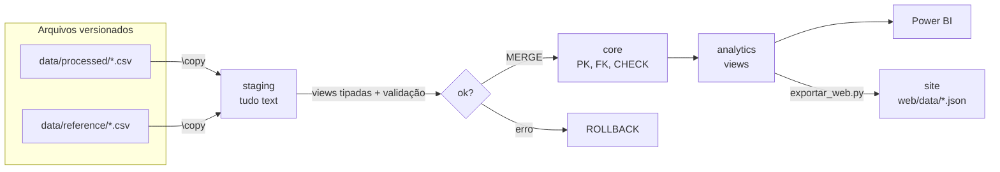
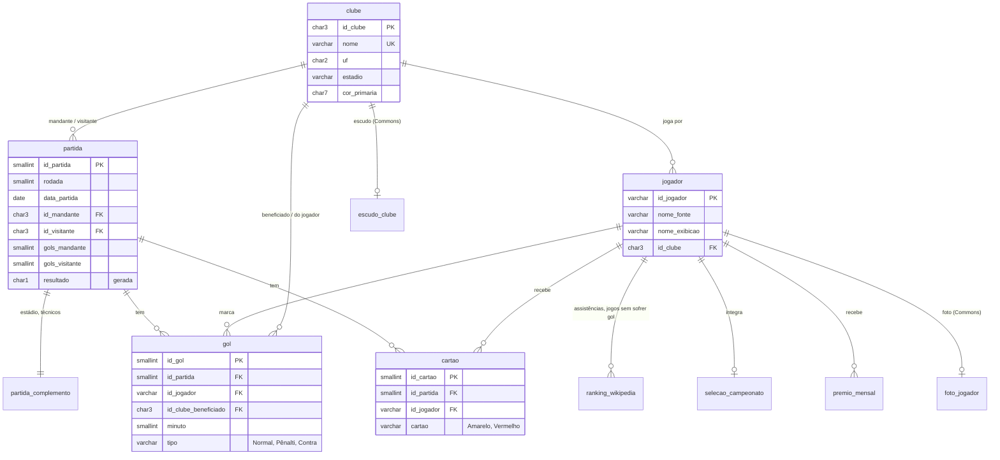

# Modelo de dados (PostgreSQL)

Implementação da [proposta da Fase 3](proposta_fase3.md), ampliada com os dados de jogadores.
Scripts em [`sql/`](../../sql), executados em ordem por `sql/executar_tudo.sql`.

## Camadas

## Schema `core`

| Tabela | Grão | Linhas | Regras principais |
|---|---|---|---|
| `clube` | clube | 20 | sigla `^[A-Z]{3}$`, nome único, cores em hexadecimal |
| `partida` | partida | 380 | um mando por confronto; um jogo por clube por rodada; placar do intervalo ≤ final |
| `partida_complemento` | partida (1:1) | 380 | estádio e técnicos obrigatórios |
| `jogador` | jogador × clube | 587 | `(nome_fonte, clube)` e `(nome_exibicao, clube)` únicos |
| `gol` | gol | 929 | período coerente com o minuto; acréscimo só aos 45 e 90; gol contra ⇔ clube do jogador ≠ beneficiado |
| `cartao` | cartão | 2.096 | tipo amarelo ou vermelho |
| `ranking_wikipedia` | jogador × métrica | 23 | métricas: assistências e jogos sem sofrer gol |
| `selecao_campeonato` | jogador | 11 | setor: goleiro, defensor, meio-campista, atacante |
| `premio_mensal` | mês × prêmio | 21 | craque, goleiro e revelação do mês |
| `escudo_clube` | clube | até 20 | arquivo do Commons, URL da miniatura nos servidores da Wikimedia (`upload.wikimedia.org` ou `thumb.wikimedia.org`), autor e licença livre (CC0, domínio público, CC BY, CC BY-SA) |
| `foto_jogador` | jogador × clube | só quem tem foto confirmada | idem, mais o item da Wikidata, o critério (`curado` ou `nome`) e quem confirmou o clube em 2024 (`confirmado_por`: `wikidata` ou `wikipedia_en`); CC BY e CC BY-SA exigem autor |
| `carga_execucao` | carga × tabela | 11 por carga | inseridas, atualizadas e removidas |

Regras que não cabem numa constraint simples (clube como mandante e visitante na mesma rodada;
gols por partida = placar; gol ou cartão de um clube que não jogou) são validadas no fim da carga
e repetidas em `sql/05_testes.sql`.

## Carga

`sql/03_carga.sql` (somente psql, a partir da raiz do projeto):

1. `TRUNCATE` da staging (único `TRUNCATE` do projeto) e `\copy` dos 13 CSVs.
2. Views tipadas (`staging.v_*`) com as mesmas colunas e tipos do core: um valor inválido gera
   erro e desfaz a carga.
3. Validação da staging (contagens, duplicidades, nomes da Wikipédia sem correspondência).
4. Sincronização genérica por catálogo (`staging.mesclar` e `staging.remover_ausentes`):
   remove o que saiu da fonte (dos filhos para os pais), depois `MERGE` (insere e atualiza só o
   que mudou, dos pais para os filhos). Compatível com PostgreSQL 15+.
5. Validação do resultado e registro em `core.carga_execucao`; `COMMIT`.

## Schema `analytics`

| View | Grão | Uso |
|---|---|---|
| `dim_clube`, `dim_jogador`, `dim_rodada` | dimensões | filtros e rótulos; `escudo_url` e `foto_url` (miniatura na Wikimedia, `NULL` sem imagem) |
| `fato_partida` | partida (380) | métricas do campeonato |
| `fato_participacao` | clube × partida (760) | métricas por clube, casa e fora |
| `fato_gol` | gol (929) | artilharia, faixas de minuto |
| `fato_cartao` | cartão (2.096) | disciplina |
| `classificacao_rodada` | clube × rodada (760) | tabela após cada rodada (reconstrução analítica) |
| `classificacao_final` | clube (20) | tabela final e destino (Libertadores, Sul-Americana, rebaixamento) |
| `jogador_estatisticas` | jogador × clube (587) | gols, pênaltis, cartões, assistências |
| `selecao_campeonato`, `premio_mensal` | — | listas da Wikipédia |
| `credito_imagem` | imagem exibida | autor, licença e página de cada escudo e foto (página de créditos do site e do Power BI) |
