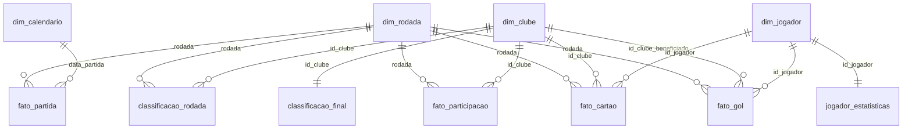

# Dashboard no Power BI

O dashboard do Brasileirão 2024 está pronto como um **projeto do Power BI (PBIP)**: em vez de um
`.pbix` binário, o modelo e o relatório ficam em arquivos de texto. Você abre o
`Brasileirao2024.pbip` no Power BI Desktop, clica em **Atualizar** e publica no Power BI Service
como faria com um `.pbix`.

**Por que PBIP e não `.pbix`?** Os arquivos de texto entram no Git como o resto do projeto: cada
mudança numa medida ou num visual aparece no *diff* e pode ser revisada. O `.pbix` é um arquivo
compactado que o Git só consegue tratar como "mudou tudo".

| Arquivo | Conteúdo |
|---|---|
| `Brasileirao2024.pbip` | Atalho que abre o projeto no Power BI Desktop |
| `Brasileirao2024.SemanticModel/` | Modelo semântico em TMDL: tabelas, consultas do Power Query, relações e as 93 medidas |
| `Brasileirao2024.Report/` | Relatório em PBIR: 11 páginas (7 visíveis, 1 de *drill-through*, 2 dicas de ferramenta e 1 de auditoria) |
| `medidas.dax` | Todas as medidas, colunas e tabelas calculadas num arquivo só, para ler fora do Desktop (gerado do modelo) |
| `gerar_imagens.py` | Baixa os escudos e fotos e grava em base64 em `dados/` para o modelo exibir sem depender da internet |
| `tema_brasileirao.json` | Tema de cores e fontes (já aplicado ao relatório) |
| `dados/*.csv` | As views do schema `analytics` exportadas por `sql/06_exportar_csv.sql`: a fonte do modelo |

## 1. Abrir no Power BI Desktop

1. Use o **Power BI Desktop atualizado** (Windows). O relatório está no formato PBIR, que é o
   padrão nas versões recentes. Se o Desktop recusar o arquivo, ative em Arquivo > Opções e
   configurações > Opções > Recursos de visualização os itens **Formato de relatório do Power BI
   Project (PBIR)** e **Armazenar o modelo semântico usando o formato TMDL**, e reinicie o Desktop.
2. Dê dois cliques em `powerbi/Brasileirao2024.pbip`.
3. Confira a pasta do projeto. As consultas leem os CSVs a partir do parâmetro `PastaProjeto`,
   que vem como `C:\Projetos\Brasileirão2024\`. Se o repositório estiver em outro lugar:
   Página Inicial > Transformar dados > **Editar parâmetros**, informe a pasta com a barra
   invertida no final e aplique.
4. Clique em **Página Inicial > Atualizar**. O projeto não guarda os dados (o cache local fica
   em `.pbi/` e não vai para o Git), então os visuais ficam vazios até a primeira atualização.
5. Confira a página oculta **Auditoria** (no Desktop as páginas ocultas aparecem nas abas com um
   ícone de olho riscado). O último cartão precisa dizer *"OK: os números de controle conferem"*:
   929 gols pelas partidas e pelos eventos, 380 partidas, 760 participações, 2.096 cartões,
   1.039 pontos e saldo 0.
6. Salve com Ctrl+S. O Desktop grava as mudanças de volta nos arquivos de texto.

No Desktop, os botões de navegação da barra lateral funcionam com **Ctrl + clique**; no Service,
com clique simples.

## 2. Páginas

Cada página responde a uma pergunta, com no máximo 4 cartões e 3 gráficos, na identidade do
tom do ge: faixa verde `#06AA48` com o título em branco e barra lateral verde-escura `#0A4F29`
com a navegação e os filtros. Tela 16:9 (1280 × 720), grade de 12 colunas, nada sobreposto.

| Página | Pergunta | O que tem |
|---|---|---|
| Visão geral | Como foi o campeonato? | Período (turno/returno); cartões de gols, média por jogo, % de vitórias do mandante e % de empates; gols por rodada; topo da tabela com escudos; top 5 artilheiros |
| Classificação | Quem terminou onde, e como chegou lá? | Rodada (começa na 38ª); tabela completa com escudo, posição colorida pela zona, P, J, V, E, D, SG, % e variação de posição; linhas da disputa pelo título e da fuga do rebaixamento |
| Clube | Como foi a temporada deste clube? | Clube (começa no Botafogo); faixa do título na cor do clube; escudo; posição final, pontos, aproveitamento e saldo; posição rodada a rodada; gols em casa e fora; quando marca e quando sofre |
| Jogos do clube | Todos os jogos, artilheiros e técnicos | Os 38 jogos com resultado colorido; artilheiros do clube; técnicos com jogos, pontos e aproveitamento |
| Jogadores | Quem se destacou? | Ranking escolhido na segmentação (gols, assistências, jogos sem sofrer gol, pênaltis, amarelos, vermelhos); líder com foto; seleção do campeonato com fotos |
| Gols e disciplina | Quando e como saem os gols e os cartões? | Cartões de pênaltis, gols contra, cartões por jogo e vermelhos; gols por faixa de minuto (mandante × visitante); cartões por clube |
| Sobre os dados | De onde vêm os dados? | Fontes, licenças, como ler e a tabela de créditos de cada imagem |
| Ficha do jogador | *drill-through* (oculta) | Botão direito num jogador > Drill-through > Ficha do jogador: foto, clube, posição, gols, pênaltis, assistências, amarelos e a lista de gols |
| Dica do clube / Dica do jogador | dicas de ferramenta (ocultas) | Aparecem ao passar o mouse sobre um clube ou jogador |
| Auditoria | oculta | Os 7 números de controle e o status |

### Filtros e interação

- **Filtros na barra lateral**, sempre no mesmo lugar e abaixo do rótulo *Filtros*: período (turno ou
  returno), **intervalo de rodadas** (controle deslizante), rodada da classificação, clube, ranking,
  clube do jogador e **posição**.
- **Sincronizados entre páginas:** o intervalo de rodadas vale para Visão geral, Clube, Jogos do clube e
  Gols e disciplina; o clube escolhido vale para Clube e Jogos do clube; o período, para Visão geral e
  Gols e disciplina.
- **Limpar filtros:** botão nas páginas com filtros livres (nas páginas de clube não há, porque elas
  sempre mostram um clube).
- **Dicas ao passar o mouse:** nos clubes aparece um cartão com escudo, posição final, pontos,
  aproveitamento e saldo; nos jogadores, foto, clube, gols, assistências, pênaltis e amarelos.
- **Clique para filtrar:** clicar num clube, jogo ou técnico filtra os outros visuais da página.
- **Ficha do jogador:** botão direito num jogador > Drill-through > Ficha do jogador.
- **Cartões com contexto:** o título de cada número traz uma referência (média da liga, destino na
  tabela, quantos jogos), que muda com os filtros.
- **Autor:** a barra lateral traz *Desenvolvido por Thiago Miranda* com o link do GitHub.

## 3. Modelo (esquema estrela)

| Tabela | Grão | Linhas |
|---|---|---|
| `dim_clube` | clube | 20 |
| `dim_jogador` | jogador × clube | 587 |
| `dim_rodada` | rodada | 38 |
| `dim_calendario` | dia de 2024 (abril a dezembro), tabela calculada e marcada como tabela de datas | 275 |
| `fato_partida` | partida | 380 |
| `fato_participacao` | clube × partida | 760 |
| `fato_gol` | gol | 929 |
| `fato_cartao` | cartão | 2.096 |
| `classificacao_rodada` | clube × rodada | 760 |
| `classificacao_final` | clube | 20 |
| `jogador_estatisticas` | jogador × clube | 587 |
| `credito_imagem` | imagem (escudo ou foto), sem relação | conforme a busca de imagens |
| `imagem_escudo`, `imagem_foto` | pedaço da imagem em base64 (ocultas), ligadas a `dim_clube` e `dim_jogador` | geradas por `gerar_imagens.py` |
| `Ranking` | métrica do ranking, tabela desconectada | 6 |
| `Medidas` | só guarda as medidas | 0 |

Relações (todas de um para muitos, filtrando da dimensão para o fato, exceto onde indicado):

| De (1) | Para (*) | Ativa | Observação |
|---|---|---|---|
| `dim_rodada[rodada]` | `fato_partida`, `fato_participacao`, `fato_gol`, `fato_cartao`, `classificacao_rodada` | Sim | Filtro de rodada para tudo |
| `dim_clube[id_clube]` | `fato_participacao[id_clube]` | Sim | Métricas por clube |
| `dim_clube[id_clube]` | `fato_participacao[id_adversario]` | **Não** | Use `USERELATIONSHIP` para "contra quem" |
| `dim_clube[id_clube]` | `fato_gol[id_clube_beneficiado]` | Sim | Gols a favor do clube |
| `dim_clube[id_clube]` | `fato_cartao[id_clube]`, `classificacao_rodada[id_clube]` | Sim | |
| `dim_clube[id_clube]` | `imagem_escudo[id_clube]` | Sim | Escudo embutido |
| `dim_jogador[id_jogador]` | `imagem_foto[id_jogador]` | Sim | Foto embutida |
| `dim_clube[id_clube]` | `classificacao_final[id_clube]` | Sim (1:1, ambas as direções) | |
| `dim_jogador[id_jogador]` | `fato_gol[id_jogador]`, `fato_cartao[id_jogador]` | Sim | |
| `dim_jogador[id_jogador]` | `jogador_estatisticas[id_jogador]` | Sim (1:1, ambas as direções) | |
| `dim_calendario[Data]` | `fato_partida[data_partida]` | Sim | |

Escolhas do modelo e por quê:

- **Fonte nos CSVs, não direto no PostgreSQL.** Os CSVs são as próprias views do `analytics`,
  exportadas por `sql/06_exportar_csv.sql`, então a regra "uma fonte da verdade" continua valendo.
  A vantagem é que o relatório abre em qualquer máquina e é publicado no Service sem precisar de
  *gateway* para o banco.
- **Power Query tolerante.** Cada consulta escolhe as colunas pelo nome com
  `MissingField.UseNull`, troca texto vazio por nulo (ausente fica vazio, nunca zero) e converte
  `t`/`f` em Verdadeiro/Falso. Colunas de imagem que ainda não existam no CSV entram vazias, e
  `credito_imagem.csv` é opcional: o relatório abre antes de a busca de imagens rodar.
- **Sem relação entre `dim_jogador` e `dim_clube`**: criaria dois caminhos de `dim_clube` até
  `fato_gol`. O clube do jogador já está em `dim_jogador[clube]`. Também não há relação entre
  `fato_partida` e `dim_clube` (são dois clubes por partida).
- **Tabela `Ranking` em vez de parâmetro de campo.** Uma tabela desconectada com a lista de
  métricas e uma medida `SWITCH` fazem o mesmo papel e ainda deixam o título e a nota do gráfico
  mudarem com a escolha (ex.: avisar que assistências é ranking parcial).
- **Colunas calculadas só para rótulos e ordenação**: `dim_jogador[jogador]` (nome · sigla, para
  eixos e *drill-through* sem juntar homônimos), `fato_partida[confronto]`,
  `fato_participacao[adversario]` e `[placar]`, `fato_gol[jogo]`. Nenhum número do dashboard vem
  de coluna calculada. A ordem das posições (`dim_jogador[ordem_posicao]`) é feita no Power Query:
  uma coluna DAX calculada a partir de `posicao` não pode ordenar a própria `posicao` (o Power BI
  acusa dependência circular).

## 4. Medidas

As medidas ficam em `Brasileirao2024.SemanticModel/definition/tables/Medidas.tmdl`, em 6 pastas
de exibição (campeonato, clubes, classificação, jogadores, disciplina, auditoria e rótulos dinâmicos). O
`medidas.dax` é gerado da mesma lista e serve para leitura. Cada medida lê a tabela do seu grão:
o total de gols vem de `fato_partida` (929), porque somar em `fato_participacao` dá 1.858.

**Duas medidas corrigidas** em relação à versão anterior do `medidas.dax`:

- `Variação de posição`: com uma rodada selecionada, a rodada anterior ficava fora do filtro e a
  medida voltava vazia. Agora usa `REMOVEFILTERS ( dim_rodada )` antes de ler a rodada anterior.
- `Posição final`: fixava a rodada 38, mas o filtro de rodada continuava valendo; com outra rodada
  selecionada, voltava vazia. Agora lê `classificacao_final`, que é a tabela conferida com a CBF.

**Decisão pendente:** o `Aproveitamento` aparece com 1 casa decimal (Athletico 36,8%), enquanto a
CBF trunca para inteiro (36). A medida está descrita assim no modelo e na página Sobre os dados.

## 5. Escudos e fotos

As imagens vêm de `dim_clube[escudo_url]`, `dim_jogador[foto_url]` e `credito_imagem.csv`, que a
busca verificada pela Wikidata grava no banco e o `sql/06_exportar_csv.sql` exporta. Só entram
arquivos do Wikimedia Commons com licença livre e, nas fotos, jogadores confirmados pela Wikidata.

Sem imagem confirmada, o relatório não inventa: o clube aparece com a sigla num círculo nas suas
cores e o jogador com a **camisa do clube e as iniciais**, nunca um rosto genérico. Isso é feito
pelas medidas `Escudo ou sigla` e `Foto ou camisa` (categoria URL de imagem), que montam um SVG
quando a URL está vazia. Os 3 escudos de Corinthians, Bragantino e Vasco são de uso justo
(`licenca` = "Uso justo", sem `licenca_url`), como no site; o crédito aparece na página Sobre os dados.

**Imagens embutidas.** O Power BI Desktop nem sempre consegue exibir a imagem pela URL da
Wikimedia (a tabela mostra só o nome). Por isso as imagens ficam dentro do modelo:

    py -3.14 -I powerbi/gerar_imagens.py

O script baixa cada escudo e foto uma vez e grava `dados/imagem_escudo.csv` e
`dados/imagem_foto.csv` em base64, em pedaços de até 30.000 caracteres (o Power BI corta textos
acima de 32.766). As medidas juntam os pedaços; se uma imagem não baixar, usam a URL e, sem URL, a
sigla ou a camisa. Sem esses dois arquivos o relatório abre normalmente, só sem as imagens embutidas.

Depois de exportar os CSVs de novo, rode o script e clique em **Atualizar** no Desktop.

## 6. Publicar no Power BI Service

1. No Desktop: Página Inicial > **Publicar** > entre com sua conta do Power BI e escolha o
   workspace (ex.: *Meu workspace*). O Desktop envia o modelo com os dados importados e o
   relatório.
2. No Service (app.powerbi.com), abra o relatório e confira as páginas. Os escudos e fotos
   vão embutidos no modelo (não dependem da Wikimedia); as siglas e camisas são geradas pelo
   próprio relatório.
3. Atualização: os dados vêm de CSVs no seu computador, então o Service não consegue atualizá-los
   sozinho (precisaria de um *gateway*). Como a temporada 2024 está fechada, não é necessário:
   quando mudar os CSVs, atualize no Desktop e publique de novo, substituindo o relatório.
4. Para o portfólio: Arquivo > Inserir relatório > **Publicar na Web (público)** gera um link e um
   código de inserção para o GitHub ou o LinkedIn. Esse recurso precisa estar liberado pelo
   administrador da conta e deixa o relatório público; aqui todos os dados já são públicos.
5. Exporte uma imagem de cada página (Arquivo > Exportar > PDF, ou captura de tela) para
   `docs/img/powerbi-<pagina>.png`, para o README principal mostrar o dashboard.

## 7. Alterar o relatório

Pode editar à vontade no Desktop e salvar: o PBIP continua sendo o arquivo do projeto. Se
quiser trocar o tema, use Exibir > Temas > Procurar temas > `tema_brasileirao.json` (o arquivo
desta pasta e a cópia registrada dentro do relatório são o mesmo tema). Se alterar uma medida
no Desktop, o `medidas.dax` fica desatualizado até ser gerado de novo; a referência é sempre o
`Medidas.tmdl`.
